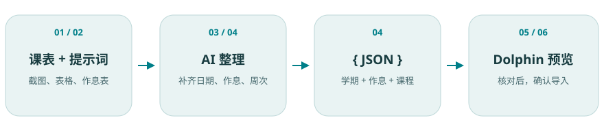
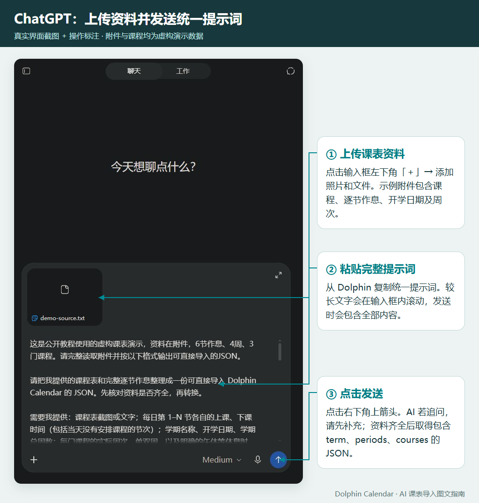
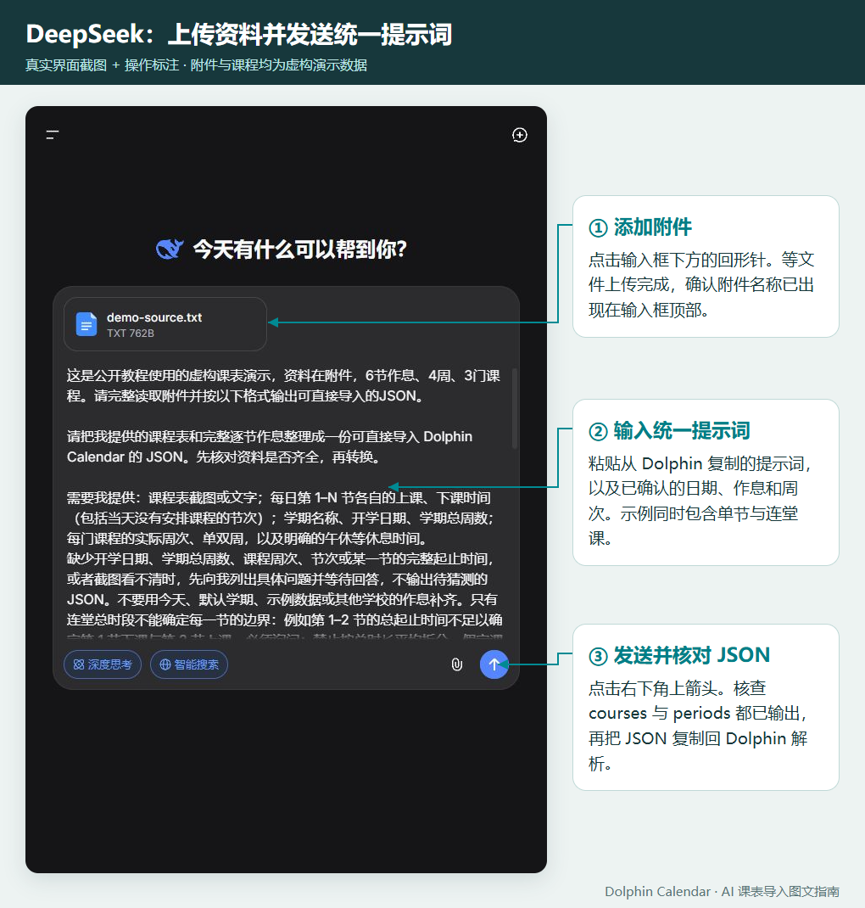
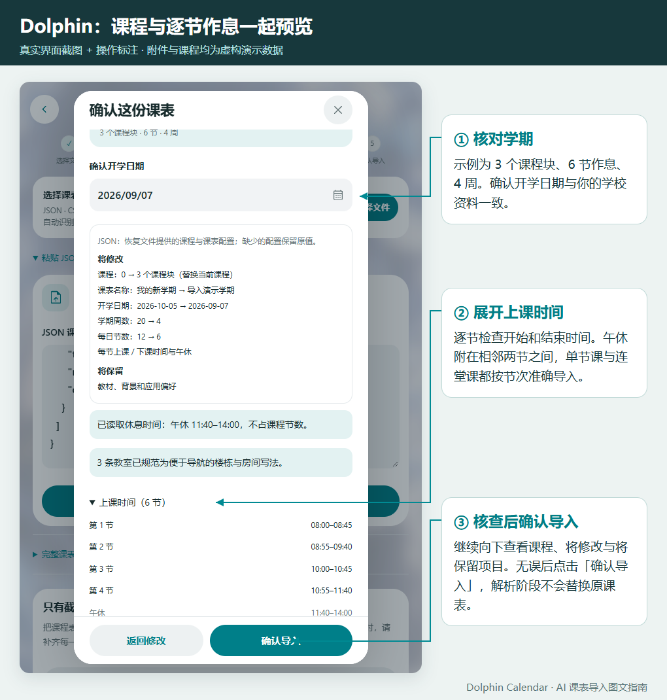

# 用 AI 整理课表，再导入 Dolphin Calendar

[打开图文与视频教程](https://tequed232.github.io/Dolphin-Calendar/import-guide/) · [返回应用](https://tequed232.github.io/Dolphin-Calendar/)

本教程适用于 ChatGPT 或 DeepSeek。教程及练习文件只使用合成数据，公开页面不包含学生课表或其他个人资料。

流程图标出了每个阶段；[交互图文页面](https://tequed232.github.io/Dolphin-Calendar/import-guide/)提供应用入口示意图、带标注的 AI 操作示例和完整视频。页面无需登录即可阅读，ChatGPT / DeepSeek 服务本身的访问条件由相应服务决定。

## 带文字标注的操作图

### ChatGPT：上传课表，再发送统一提示词

### DeepSeek：补齐必要资料，取得 JSON

两张图使用教学合成课表，不包含学生资料。按图上的编号操作，再核对 AI 结果与源表是否一致。

### Dolphin：预览修改与保留项，最后确认

[观看应用内导入演示视频](https://tequed232.github.io/Dolphin-Calendar/import-guide/import-demo.webm)：提示词入口、粘贴 JSON、检查时间、确认保存。外部 AI 的文件上传与对话见上方操作图；视频不声称展示外部 AI 操作。

## 操作流程

1. 准备清晰课表截图 / 文件，以及学校逐节作息表。确认实际开学日期、学期总周数、课程周次和单双周。
2. 在 Dolphin 的「导入课表」中点击「向 AI 输入提示词导入课表」，再在弹框中点击「复制提示词」。公开教程也可读取构建时从同一源码导出的提示词，避免格式分叉。
3. 打开 [ChatGPT](https://chatgpt.com/) 或 [DeepSeek](https://chat.deepseek.com/) 的新对话，上传课表文件 / 截图，粘贴提示词和已知信息后一同发送。附件入口以当前服务界面为准；所选模式不支持图片时，使用清晰文本或支持图片的入口。
4. AI 追问缺失信息时，依据学校资料补齐，尤其是开学日期、每一节起止时间和周次。取得包含 `term`、`periods`、`courses` 的 JSON，复制从 `{` 到 `}` 的内容。
5. 回到 Dolphin →「导入课表」→「粘贴 JSON 内容」→「解析并预览」。也可保存为 `.json` 文件后选择文件导入。检查课程、日期、上课 / 下课 / 休息时间以及「将修改 / 将保留」。
6. 检查无误后点击「确认导入」。含课程的导入会替换当前课程，教材、背景及应用偏好保留；仅更新时间配置的文件保留原课程。实际行为以预览说明为准。最后在列表、平铺和一个已知有课日期上核对结果。

解析及预览阶段不替换原课表；解析失败时原课表保持不变。导入前可先导出原课表作为备份。把 AI 输出与学校资料逐项核对后再确认。

## 格式要点

| 数据 | 字段及含义 |
| --- | --- |
| 学期 | `term.name` 名称、`term.startDate` 实际开学日期（YYYY-MM-DD）、`term.weeks` 总周数 |
| 作息 | `periods` 按真实课节顺序排列；每项 `start` / `end` 为 HH:mm；可在休息前一节附加 `breakAfter` |
| 课程 | `name`、`teacher`、`room`、`day`、`start`、`end`、`weeks`；可带 `color`、`notes` |
| 星期 | `day` 为 1–7，周一 = 1，周日 = 7 |
| 课程跨度 | 课程 `start` / `end` 是起止节次编号，不是钟点 |
| 周次 | `weeks` 是数字数组；单周明确列出 `[1,3,5,…]`，双周列出 `[2,4,6,…]` |
| 午休 / 晚休 | 不占课程节次，按实际休息时段配置，不能在课程数组里添加虚假休息课程 |

第 1 周按开学日期所在周的周一计算。课程冲突在预览中提示，确认后同时保留，请核查源表后决定。

学校课表如果只写「第 1–2 节，08:00–09:40」，无法知道第 1 节结束、第 2 节开始的钟点。**不能无依据平均拆分或猜测课间**；应补学校的逐节作息表。用户已经明确确认单节时长、课间时长及其适用范围时，可以按确认的规则计算，并逐项核对总时段、休息和末节结束时间。缺少配置时应用可能保留当前值，这不等于学校配置已确认。

CSV / Excel 的课程行可提供课程总起止钟点，但连堂中间节次不会据此推算。CSV 不设置开学日期，沿用当前学期配置；时间表导入和课程导入分别在预览中说明修改、保留的内容。

## 合成练习文件

[应用统一 JSON 模板](https://tequed232.github.io/Dolphin-Calendar/import-guide/schedule.json) · [应用统一 CSV 模板](https://tequed232.github.io/Dolphin-Calendar/import-guide/schedule.csv)。这两份由应用统一模板生成，采用 12 节完整作息与 3 门合成课程，和下列 6 节练习示例不同。

- [完整 JSON 练习示例](import-guide/synthetic-schedule.json)：4 周合成学期，6 节逐节作息，3 门课程，含单周和午休。
- [完整 CSV 练习示例](import-guide/synthetic-complete.csv)：6 节作息、午休和 3 门课程在同一份文件中。

这些日期、教师、教室和作息仅供练习，不代表实际学校。使用外部 AI 时，可先遮去与转换无关的姓名、学号和联系方式；公开教程本身不读取或上传用户课表。

## 教程页面与媒体维护

静态页面位于 `docs/import-guide/`，不依赖应用业务状态、登录或外部 CDN；支持系统、浅色、深色主题及手机横竖屏。`prompt.txt` 由构建流程从应用统一提示词生成，不在教程中另写一份。

页面的本地步骤示意图可以独立指导操作。发布可用的合成录制素材时，将 `chatgpt-step.png`、`deepseek-step.png`、`app-import-step.png` 和 `import-demo.webm` 放入同一目录。带文字标注的 PNG 由真实合成演示截图制作；原始 `chatgpt-demo.jpg`、`deepseek-demo.jpg` 可保留为回退图片；页面确认文件存在后才展示图片或视频，缺少文件时保持图文指南，不生成失效图片链接。视频不自动播放，完整步骤同时提供文字说明。
